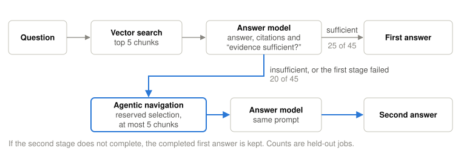
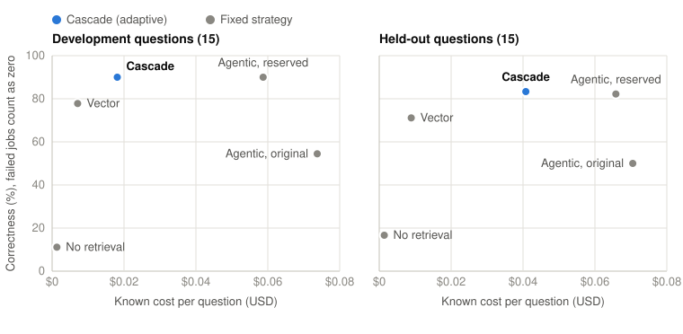
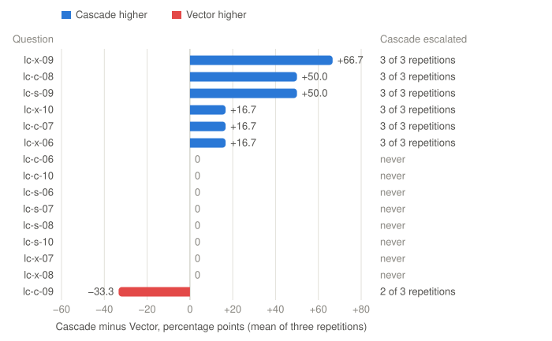

# 1 Introduction

A language model answers questions about a software repository better when it
is shown the relevant source. There are two common ways to find that source.
*Vector search* embeds the question once and returns the stored chunks of code
whose embeddings are nearest to it [@lewis2020rag; @douze2024faiss]. It costs
one embedding request and a fast index lookup. *Agentic search* gives the model
tools to list directories, search for symbols and read files, and lets it
explore over several turns [@yao2023react; @yang2024sweagent]. It can follow a
call path across files, but each turn is another model request over a growing
prompt.

Adaptive retrieval is the idea of using the expensive method only when it is
needed. Earlier work decides whether and how to retrieve from the question
[@jeong2024adaptive], from the model's own generation
[@asai2024selfrag; @jiang2023active] or from a check on what was retrieved
[@yan2024crag]. A related line of work sends a query to a cheap model first and
to a costly one only when the cheap answer looks unreliable
[@chen2023frugalgpt; @aggarwal2023automix; @ong2025routellm].

This paper is a small, fully recorded pilot study of adaptive retrieval in one
setting: questions about the LangChain repository [@chase2022langchain] at one
pinned commit, answered by one model. We report the work in the order it
happened, including the part that failed.

1. **Routing before retrieval failed.** Two routers that picked a strategy from
   the question text scored 42% and 39% on development questions, against 74%
   for always using vector search.
2. **A diagnosis explained why.** The routers chose badly, and the agentic
   navigator they often chose was stopped by its budget after it had already
   been shown the evidence, so it returned nothing.
3. **Two changes followed.** A navigator that holds its final evidence
   selection in reserve, and a cascade that runs vector search first and
   escalates only when the first answer reports insufficient evidence.
4. **One held-out test.** Three comparisons, and the words that would describe
   each outcome, were fixed before a single run on 15 questions that had played
   no part in the design.

The held-out test supports two claims and leaves two open. The
reserved-selection navigator was more correct than the original, and the cascade cost
less and took less time than always using the navigator. The cascade scored
higher than vector search alone, but the interval for that difference starts at
zero, so we report it as a direction only. The cascade's correctness could not
be distinguished from the navigator's, which is weaker than showing they are
the same.

We do not claim that the cascade is cheaper than vector search, which it
cannot be because it always runs vector search first, or that any of this holds
for other repositories, models or question sets. The contribution is a worked
and auditable example: a negative result, a concrete failure of an agentic
retriever with its fix, and a pre-specified test whose outcome is reported as
the rules fixed in advance classify it.

# 2 Related work

**Retrieval-augmented generation.** Retrieval-augmented generation supplies a
generator with passages found by a retriever [@lewis2020rag]. For code,
retrieval from the repository and from other sources has been studied for
completion and generation [@zhang2023repocoder; @wang2025coderagbench]. Our
vector condition is the
standard single-shot form: dense embeddings [@zhang2025qwen3] in a flat
inner-product index [@douze2024faiss].

**Agentic retrieval.** Interleaving reasoning with tool calls lets a model
gather information step by step [@yao2023react], and purpose-built interfaces
for navigating and reading code make such agents effective on software tasks
[@yang2024sweagent]. Our agentic condition is a restricted form of this: five
read-only tools and a hard budget, with the agent's only output being the
excerpts it selects.

**Adaptive retrieval.** Adaptive-RAG trains a classifier to predict question
complexity and picks no retrieval, single-step or multi-step retrieval
accordingly [@jeong2024adaptive]. Self-RAG trains the generator to decide when
to retrieve and to critique its output [@asai2024selfrag]. FLARE retrieves when
the generator is about to produce low-confidence text [@jiang2023active], and
Corrective RAG scores retrieved documents and triggers a different action when
they look poor [@yan2024crag]. Our first design resembles the first of these in
deciding before retrieval, without training. The cascade is closer to the last
two: it decides after a first attempt, using the answer model's own report.

**Cascades and routing for cost.** FrugalGPT learns a cascade over language
models that stops when an answer is judged reliable [@chen2023frugalgpt].
AutoMix asks the small model to verify its own answer and escalates when the
verification is weak [@aggarwal2023automix], and RouteLLM learns a router
between a strong and a weak model [@ong2025routellm]. We apply the same idea to
retrieval strategies under one answer model, and the escalation signal is a
single self-reported boolean.

**Evaluation practice.** Language-model judges can agree well with human
preferences but have known biases [@zheng2023judging]. We use an AI reviewer
and say so throughout. Fixing hypotheses and analyses before seeing outcomes
separates prediction from postdiction [@nosek2018preregistration]; we follow
that practice locally, as Section 5.4 describes.

# 3 Setting and systems

## 3.1 Corpus and index

The corpus is the LangChain repository at commit
`ea17e48f0a4336c920394fd029de99f1568b4c38`. After excluding lock files,
generated and vendored files, build artifacts and files over 1 MB, it holds
3,119 files and 19.0 MB of text, of which 2,653 files are Python. Files are split into chunks at top-level syntax boundaries where a
parser is available, with at most 80 lines or 12,000 characters per chunk and
an eight-line overlap when a block has to be cut. This yields 9,404 chunks.
Each chunk is embedded with Qwen3-Embedding-8B [@zhang2025qwen3] into 4,096
dimensions, normalized, and stored in a flat inner-product FAISS index, so
ranking is by cosine similarity [@douze2024faiss]. The index was built once and
is shared by every run reported here.

## 3.2 Retrieval conditions

Every condition returns at most five source excerpts, capped at 24,000
characters in total, to the same answer step.

**Vector.** Embed the question and return the five most similar chunks.

**Agentic, original.** A tool-using navigator receives the question and five
read-only tools: list a directory, find files by path pattern, find symbol
definitions, find textual references to a symbol, and read a range of lines.
Each retrieval is limited to 12 model requests, 24 tool calls, 128,000 budgeted
tokens and 300 seconds. The navigator finishes by selecting up to five of the
excerpts it was shown. If it stops in any other way, retrieval fails, no answer
is generated and the job counts as a failure.

**Agentic, reserved selection.** The same navigator, tools and limits, changed
so that it can always hand in a selection. Section 6.3 describes the change.

**Cascade.** Vector first; escalate once to the reserved-selection navigator
when the first answer reports insufficient evidence. Section 6.3 gives the
rule, and Figure 1 shows the flow.

**No retrieval.** The answer model receives the question with no evidence. This
measures what the model already knows about a public repository.

Three further conditions appear only in the first development run: a
deterministic keyword and symbol retriever with no model requests
("Vectorless"), a rule-based router and a model-based router. Each router chose
one of Vector, Vectorless or Agentic from the question text before any
retrieval.

::: {.figbox}
{width=100%}

**Figure 1.** The vector-first cascade. The blue path is taken only when the
first answer reports that its evidence is insufficient or the first stage
fails. Counts are held-out jobs.
:::

## 3.3 Shared answer generation

One answer step serves every condition. The answer model receives the question
and the retrieved excerpts and must return a JSON object with an answer and the
identifiers of the excerpts it cites. Citations that do not refer to a supplied
excerpt make the job fail. The model may use its own knowledge when evidence is
missing, but must say so.

For the redesign we added one required field, `evidence_sufficient`. The prompt
instructs the model to set it to true only if the supplied excerpts by
themselves support every part of the answer, and to false if any part depends
on model knowledge or on source that is not shown. Appendix C quotes the
instruction. Every condition in the second development run and the held-out run
uses this prompt, so that conditions differ only in retrieval.

## 3.4 Models, budgets and accounting

Navigation and answers use Claude Haiku 4.5 (`claude-haiku-4-5-20251001`) at
temperature zero [@anthropic2025haiku]. A navigation request may produce at
most 512 output tokens and an answer at most 1,024.

**Cost.** Cost is estimated from the token usage the provider reports, at list
prices of \$1 per million input tokens and \$5 per million output tokens for
the chat model and \$0.04 per million tokens for embeddings. A request that
fails without reporting usage has unknown cost; its job is left out of the
condition's cost and named. Building the index is a one-time shared cost and is
excluded.

**Token budget.** Before each request the framework charges the whole
serialized prompt against the remaining token budget at one token per byte.
This is deliberately conservative: the provider counted a median of 2.99 bytes
per token in the first development run. Section 6.2 shows why this mattered.

**Pacing.** Requests are sent one at a time, at least six seconds apart and at
most ten per minute, to stay within provider rate limits. Elapsed times
therefore include waiting. They compare conditions under identical pacing and
are not provider latencies.

**Failures.** Nothing is retried automatically. A failed job is kept, scores
zero and stays in the denominator.

# 4 Benchmark

The benchmark has 30 questions about the pinned commit: ten conceptual, ten
structural and ten cross-file. Each question has a reference answer and one to
five evidence ranges, given as a file path, a line range and a hash of the
exact text. Table 1 shows one development question of each kind.

Questions and reference answers were drafted with an AI coding assistant by
inspecting the source. The author then checked every question, answer and
evidence range against the source at the pinned commit, and that review is
recorded with each question. Five questions of each kind were assigned to a
development split and five to a held-out split before any tuning, and the
benchmark was frozen with its hashes on November 16, 2026. By the difficulty
labels assigned at authoring, the held-out split is the harder one: six of its
questions are labelled hard, against three in the development split.

::: {.tablebox}
**Table 1.** One development question from each category.

| Category | Example question |
| --- | --- |
| Conceptual | If an `Embeddings` subclass intentionally implements different synchronous document and query encoders but inherits both asynchronous methods, do the asynchronous calls preserve that distinction, and how are they delegated? |
| Structural | In the core document-loading interfaces, which abstract class defines parsing a `Blob` into a lazy stream of `Document`s? Locate the class and the exact abstract method signature a subclass must implement. |
| Cross-file | A custom `Embeddings` subclass inherits `aembed_documents` and its synchronous `embed_documents` raises `StopIteration`. What exception should awaiting `aembed_documents` surface through LangChain's executor helper, and how are executor selection and context propagation determined? |
:::

The questions ask about specific behaviour that can be checked in the code.
The low scores of the no-retrieval condition (Sections 6 and 7) suggest that
most cannot be answered from general knowledge of the library.

# 5 Evaluation method

## 5.1 Design

A run crosses a set of questions with a set of conditions and three
repetitions. The job order is shuffled with a fixed seed. Three runs are
reported: two on the 15 development questions and one on the 15 held-out
questions (Table 2). Together they cost about \$23 in model usage at list
prices.

::: {.tablebox}
**Table 2.** The three runs. A job is one question under one condition in one
repetition.

| Run | Questions | Conditions | Jobs | Scored by |
| --- | --- | ---: | ---: | --- |
| Development 1 (November 17) | 15 development | 6 | 270 | The author |
| Development 2 (November 19) | 15 development | 5 | 225 | AI reviewer, reviewed by the author |
| Held-out (November 19) | 15 held-out | 5 | 225 | AI reviewer, reviewed by the author |
:::

## 5.2 Scoring

Each answer receives a correctness score: 1 if every material part of what was
asked is correct, 0.5 if substantive parts are correct but a material part is
missing or wrong, and 0 if the answer is wrong or abstains without substance.
Support for the claims by the cited source is scored separately on the same
scale.

Answers are exported for scoring in shuffled order with no condition label.
Each score is bound to a hash of the exact answer record, so a score cannot be
attached to a different or altered answer.

The first development run was scored by the author. For the second development
run and the held-out run, an AI reviewer scored each distinct answer against
the pinned source, assessing identical answers to the same question once. Its
freeze records state that it had no access to condition labels, run records or
aggregates. Its scores were frozen, with hashes recorded, before any result by
condition was computed. The author then reviewed the scores and recorded an
attestation; no separate human scores were supplied. We describe these results
as scored by an AI reviewer and reviewed by the author, and not as independent
human scoring.

## 5.3 Primary metric and uncertainty

The primary metric is *failure-aware correctness*: the mean correctness score
over all 45 planned jobs of a condition, with every unsuccessful job counted as
zero. A method that answers well when it finishes but often fails to finish
should not look good, and under this metric it does not.

The unit of analysis is the question, not the job. For each question and
condition we average the three repetitions, and for a comparison we take the
difference of those question means. Intervals are percentile bootstrap
intervals over questions [@efron1993bootstrap], with 2,000 resamples and seed
0, at the 95% level. No adjustment is made for multiple comparisons.

## 5.4 The pre-specified held-out test

Before the held-out run, a protocol fixed the code, prompts, limits and
settings, which are those of the second development run with only the question
split changed. It also fixed three comparisons and how each result would be
worded.

1. **Cascade minus Vector**, on correctness.
2. **Cascade against reserved-selection Agentic**, on correctness, on known
   cost per job and on elapsed time per job.
3. **Reserved-selection Agentic minus original Agentic**, on correctness.

A directional result is *supported* if the estimate is in the stated direction
and the 95% interval excludes zero, *direction only* if the interval includes
zero, and *not supported* if the estimate is zero or in the opposite direction.
For the cascade's quality against Agentic, the two are called *similar* only if
the whole interval lies within ten points either side of zero; otherwise they
are *not distinguishable at this sample size*, whatever the estimate. The cost
result is stated together with the quality result and never instead of it.
Appendix A gives the rules in full.

The analysis script was written, and its hash recorded, after the run and
before any held-out score existed. It reproduces the recorded development
results exactly. Three readings that the protocol left implicit were written
into that script at the same time:

- an interval whose endpoint is at zero counts as including zero;
- elapsed time, for which the protocol fixed no wording, uses the same rule as
  cost;
- a job counts as lost to an unreachable provider if a model request raised a
  transport error.

The second of these was written when the elapsed times were already known.

This follows the practice of preregistration [@nosek2018preregistration] in a
local form. The protocol, the analysis script and the score files are
identified by hashes and timestamps in the project's records. They were not
deposited with an independent registry, so a reader has to take the recorded
order on trust.

Exposure to the held-out questions was uneven. The author, who reviewed every
question, and the assistant that drafted them had seen all 30. The assistant
session that designed the redesign and ran the analysis did not read the
held-out questions or answers; it worked from question identifiers, scores and
run metadata. The author chose the redesign from options that session proposed
from development data.

# 6 Development: what failed, why, and the redesign

## 6.1 Routing before retrieval did worse than always using Vector

Table 3 gives the first development run. Both routers scored far below the
fixed Vector condition. The paired differences were −32.2 points for the rule
router (95% interval −54.4 to −12.2) and −35.6 points for the model router
(−57.8 to −15.6). The agentic navigator scored 62.2%, against 74.4% for Vector,
at about ten times the cost.

::: {.tablebox}
**Table 3.** First development run: 15 questions, three repetitions, scored by
the author. Correctness counts failed jobs as zero. One job of the model router
has unknown cost.

| Condition | Completed of 45 | Correctness | Known cost per question | Elapsed per question (s) |
| --- | ---: | ---: | ---: | ---: |
| Vector | 43 | 74.4% | \$0.0069 | 9.4 |
| Agentic, original | 28 | 62.2% | \$0.0710 | 52.4 |
| Rule router | 36 | 42.2% | \$0.0296 | 21.5 |
| Model router | 28 | 38.9% | \$0.0561 | 42.2 |
| Vectorless | 45 | 27.8% | \$0.0044 | 8.1 |
| No retrieval | 45 | 6.7% | \$0.0013 | 5.2 |
:::

## 6.2 Diagnosis

The diagnosis used only the development run and its scores.

**The routers lost on what they chose.** Scoring each router's pick with the
fixed condition's own result for that question gives 47.8% for the rule router
and 38.9% for the model router. Selection alone therefore accounts for most of
the gap to Vector's 74.4%. The rule router sent 21 of its 45 jobs to the
weakest retriever, Vectorless, because the questions mention code identifiers.
The model router sent 27 of 45 to Agentic. Neither router sees any evidence,
and nothing follows a bad choice.

**The navigator was stopped after finding the evidence.** The navigator ran 84
times in this run, as a fixed condition and when a router chose it. Table 4
shows how those runs ended. Of the 41 that completed, 40 led to a fully correct
answer. The other 43 returned nothing, yet in 35 of them a chunk from every
reference file had already been shown to the navigator.

::: {.tablebox}
**Table 4.** How the 84 navigator runs of the first development run ended.

| How the run ended | Runs | Runs in which a chunk from every reference file had been shown |
| --- | ---: | ---: |
| Completed with a selection | 41 | 40 |
| Stopped at the token limit | 29 | 25 |
| Ended in prose instead of a selection | 7 | 6 |
| Stopped at the model-request limit | 6 | 3 |
| Connection failure | 1 | 1 |
:::

Three causes stand out.

- **The navigator was told one budget and held to another.** It was shown its
  remaining tokens, but each request was charged at one token per byte, about
  three times what the provider counted. The 29 runs that hit the token limit
  stopped with a median of 37,019 budgeted tokens unspent. Their last admitted
  prompts had a median size of 43,584 bytes, which the provider counted as
  about 14,700 tokens, and the next prompt, larger again, no longer fit.
- **Nothing was held back for the selection.** A run that reached its limit had
  no request left in which to say what it had found.
- **It sometimes answered instead of selecting.** In seven runs the navigator
  stopped calling tools and began to answer the question in prose, which is not
  a selection.

**Similarity did not predict failure, but the answer did.** The top similarity
score separated the questions Vector answered perfectly from the others with an
area under the curve of 0.39, where 0.5 is no signal. Vector's own answers were
more informative: a phrase match for statements that evidence was missing
flagged none of its 27 fully correct answers and five of its 16 partial or
zero-score answers. The phrase list was written after reading those answers, so
it shows only that a signal exists.

## 6.3 Redesign

Three changes were made, each as a separate versioned component so that the
earlier conditions still run unchanged.

**A navigator that keeps its selection in reserve.** Token accounting and all
limits are unchanged. Three things differ.

- Each request tells the navigator the exact charge for that request, whether
  navigation may end after it, and whether a selection is required now.
- A navigation request is sent only if, after charging it and the next one, a
  full selection request still fits. The last model request and the last tool
  call are also reserved. When the reserve is reached, the navigator receives
  one instruction to select from what it has been shown, and tools are no
  longer executed.
- A response that is not a valid selection may be repeated once.

**A sufficiency report in the answer.** The boolean described in Section 3.3.

**A vector-first cascade.**

1. Run Vector retrieval and the answer step, exactly as the Vector condition
   does.
2. Escalate if retrieval or the answer did not complete, or if the answer did
   not report sufficient evidence.
3. On escalation, run the reserved-selection navigator and the answer step on
   its evidence.
4. Return the second answer if it completes. Otherwise keep the completed
   first answer. Otherwise the job fails.

Every request, token, tool call and second of both stages is charged to the
job. The rule uses no benchmark label and no measured outcome, and no question
is treated specially.

## 6.4 The redesign on development questions

Table 5 gives the second development run. The reserved-selection navigator
completed 44 of 45 jobs against 27 for the original, and both it and the
cascade scored 90.0%. The cascade escalated nine jobs: three questions, in all
three repetitions each.

::: {.tablebox}
**Table 5.** Second development run: 15 questions, three repetitions, scored
by an AI reviewer. One job of each Agentic condition has unknown cost.

| Condition | Completed of 45 | Correctness | Known cost per question | Elapsed per question (s) |
| --- | ---: | ---: | ---: | ---: |
| Vector | 45 | 77.8% | \$0.0071 | 12.4 |
| Agentic, original | 27 | 54.4% | \$0.0738 | 52.7 |
| Agentic, reserved selection | 44 | 90.0% | \$0.0587 | 46.9 |
| Cascade | 45 | 90.0% | \$0.0181 | 18.5 |
| No retrieval | 45 | 11.1% | \$0.0013 | 4.5 |
:::

These questions are the ones the redesign was built on, so the run shows that
the design works where it was developed and nothing more. The two development
runs also differ in the answer prompt and in who scored them, and should not be
pooled.

# 7 Held-out results

The held-out run recorded all 225 planned jobs: 202 completed and 23 failed.
Table 6 gives the conditions, Table 7 the three pre-specified comparisons, and
Figure 2 sets correctness against cost.

::: {.tablebox}
**Table 6.** Held-out run: 15 questions, three repetitions, scored by an AI
reviewer and reviewed by the author. "Full", "partial" and "zero" count
completed answers by score. One job of the original Agentic condition has
unknown cost.

| Condition | Completed of 45 | Full | Partial | Zero | Failed | Correctness | Known cost per question | Elapsed per question (s) |
| --- | ---: | ---: | ---: | ---: | ---: | ---: | ---: | ---: |
| Vector | 45 | 26 | 12 | 7 | 0 | 71.1% | \$0.0089 | 9.2 |
| Agentic, original | 24 | 21 | 3 | 0 | 21 | 50.0% | \$0.0705 | 52.2 |
| Agentic, reserved selection | 43 | 35 | 4 | 4 | 2 | 82.2% | \$0.0658 | 52.7 |
| Cascade | 45 | 36 | 3 | 6 | 0 | 83.3% | \$0.0408 | 33.1 |
| No retrieval | 45 | 3 | 9 | 33 | 0 | 16.7% | \$0.0014 | 4.7 |
:::

::: {.tablebox}
**Table 7.** The three pre-specified comparisons on held-out questions. Each
difference is the first condition minus the second, paired over 15 questions.
The last column is the wording fixed in advance.

| | Comparison | Estimate | 95% interval | Result |
| --- | --- | ---: | ---: | --- |
| 1 | Cascade − Vector, correctness | +12.2 points | 0.0 to +25.6 | Direction only |
| 2 | Cascade − reserved-selection Agentic, correctness | +1.1 points | −8.9 to +13.3 | Not distinguishable at this sample size |
| 2 | Same pair, known cost per question | −\$0.025 | −\$0.041 to −\$0.009 | Supported: the cascade costs less |
| 2 | Same pair, elapsed time per question | −19.6 s | −31.4 to −7.4 | Supported: the cascade takes less time |
| 3 | Reserved-selection − original Agentic, correctness | +32.2 points | +14.4 to +51.1 | Supported |
:::

::: {.figbox}
{width=100%}

**Figure 2.** Correctness against known cost per question, for the second
development run (left) and the held-out run (right). The cascade sits near the
navigator's correctness at a lower cost, and well above Vector's cost.
:::

## 7.1 The navigator fix

Comparison 3 is supported. The reserved-selection navigator scored 82.2% and
the original 50.0%, a difference of 32.2 points (95% interval +14.4 to +51.1).
The original completed 24 of 45 jobs. Its 21 failures were eleven stops at the
token limit, six runs that ended in prose, three stops at the model-request
limit and one connection timeout. When it did produce an answer, that answer
scored 93.8% on average, so its loss comes from runs that never reached an
answer.

The reserved-selection navigator completed all 45 retrievals. Its selection was
forced by the reserve in 23 of them. Its two failed jobs both came at the
answer step, where the answer model wrapped its JSON in extra text.

## 7.2 The cascade against always using the navigator

The protocol requires the quality and cost results of comparison 2 to be read
together.

- **Quality.** The cascade scored 83.3% and the reserved-selection navigator
  82.2%. The interval for the difference, −8.9 to +13.3 points, reaches beyond
  the ten-point margin on the upper side, so the two cannot be called similar.
  The data do not distinguish them and do not establish equivalence or
  non-inferiority.
- **Cost.** The cascade's known cost was \$0.0408 per question against
  \$0.0658, which is 62% of the navigator's. The interval for the difference
  lies wholly below zero.
- **Time.** The cascade took 33.1 seconds per question against 52.7, which is
  63% of the navigator's, under identical pacing.

## 7.3 The cascade against Vector

Comparison 1 is direction only. The cascade scored 83.3% and Vector 71.1%, a
difference of 12.2 points, the same estimate as in development. The lower end
of the interval is zero to floating-point precision: of the 2,000 bootstrap
means, 23 are below zero and 28 equal zero, so the 2.5th percentile falls on
zero. The rule written before any score existed counts an endpoint at zero as
including zero. The result is therefore not "supported", and it sits on the
boundary of that rule.

Figure 3 shows why the interval is wide. Six questions improved, one got worse
and eight did not change, so the estimate rests on seven questions.

::: {.figbox}
{width=92%}

**Figure 3.** Held-out questions: correctness of the cascade minus Vector, by
question, with how often the cascade escalated. Every change is on a question
that escalated at least once.
:::

The cascade is not cheaper or faster than Vector. It used 4.6 times Vector's
known cost and 3.6 times its elapsed time.

## 7.4 How the cascade behaved

These results are descriptive and carry no pre-specified claim.

- **Escalation.** The cascade escalated 20 of 45 jobs, against 9 of 45 in
  development. Nineteen followed a report of insufficient evidence and one a
  first answer that failed validation. Seven of the 15 questions escalated at
  least once.
- **After escalating.** Fourteen answers scored full marks, three were partial
  and three scored zero.
- **Without escalating.** Twenty-two answers scored full marks and three scored
  zero.
- **A miss.** On one question the first stage reported sufficient evidence in
  all three repetitions and was wrong each time. The cascade never escalated
  and scored zero. The reserved-selection navigator scored 0.5, 0.5 and 0 on
  that question.
- **A loss.** On one question the fixed Vector condition was correct in all
  three repetitions. In the cascade, the first stage reported insufficient
  evidence twice, and one of the two escalated answers scored zero.

Table 8 relates the sufficiency report to the score for the fixed Vector
condition, where every first-stage answer was scored. A report of insufficient
evidence usually marked an answer that fell short, and a report of sufficient
evidence usually marked a correct one. The exceptions are the two failure modes
above: three confident wrong answers, and two correct answers that would have
been escalated needlessly.

::: {.tablebox}
**Table 8.** Held-out Vector answers by their own sufficiency report and their
score. This breakdown was not listed in the protocol.

| Reported | Answers | Full | Partial | Zero |
| --- | ---: | ---: | ---: | ---: |
| Sufficient evidence | 27 | 24 | 0 | 3 |
| Insufficient evidence | 18 | 2 | 12 | 4 |
:::

## 7.5 Sensitivity

One job was lost to an unreachable provider: a connection timeout in the
original Agentic condition. Leaving it out changes no estimate, interval or
wording, because that condition scored zero on that question in every
repetition.

# 8 Discussion

**What the pilot supports.** Two results held on questions the design had not
seen. An agentic retriever that reserves room to report what it found is much
more useful than one that does not. And when the alternative is to run that
retriever on every question, a vector-first cascade costs less and takes less
time, with correctness we could not tell apart from it.

**What it leaves open.** Whether the cascade is more correct than Vector alone
is not settled. The estimate is 12 points in both the development and the
held-out run, but the held-out interval starts at zero and rests on seven
questions. Whether the cascade is as good as the navigator is also not settled:
ruling out a ten-point difference in either direction needs more questions than
this.

**The saving depends on how often the cascade escalates.** A question that does
not escalate costs about what Vector costs, and one that does costs about
Vector plus the navigator. With escalation rate $p$, Vector cost $c_V$ and
navigator cost $c_A$, the cascade's cost per question is roughly
$c_V + p\,c_A$. This comes within about 7% of the observed cost in both runs:
\$0.0188 predicted against \$0.0181 observed in development, where $p$ was
0.20, and \$0.0382 against \$0.0408 on held-out questions, where $p$ was 0.44.
The saving over the navigator therefore shrinks as questions get harder for
Vector. Under this approximation it disappears when 86% to 88% of questions
escalate, depending on which run's costs are used. On a workload where Vector
is usually enough the cascade is close to Vector in cost. On one where it
rarely is, the cascade costs slightly more than running the navigator directly.

**Deciding after a first attempt worked better than deciding before.** The
routers had only the question text and chose badly. The cascade waits until a
first answer exists and asks the answer model whether its evidence was enough.
That report was informative on held-out questions (Table 8), and it costs no
extra request.

**The escalation signal has two failure modes.** It cannot catch an answer that
is confidently wrong, and it is not stable across repetitions of the same
question, so it sometimes discards a correct answer. Both were seen once among
15 held-out questions. A check on the first answer that does not rely on the
model's own confidence is the obvious next thing to test.

**An agent should be told the budget it is held to.** The original navigator's
failure was an accounting mismatch more than a reasoning failure. It was shown
one measure of its remaining budget and charged by another, with nothing kept
back for its final output. On held-out questions the original navigator failed
to return a selection in 21 of 45 jobs, one of them a connection timeout. With
the last request reserved and the real charge shown, the navigator returned a
selection in all 45, and no limit was raised. We expect this to matter for any
tool-using agent that must return a structured result under a hard budget.

**Retrieval can hurt.** One held-out question was answered correctly with no
retrieval in all three repetitions and by Vector, while the reserved-selection
navigator scored 0.33 on it. Model knowledge of a public repository contributes
to these scores, and more retrieval is not always better.

# 9 Limitations

- **Sample size.** Fifteen held-out questions give intervals of roughly ten to
  twenty points either side. Three repetitions per question measure
  run-to-run variation and do not add questions. No adjustment was made for
  three comparisons.
- **One setting.** One repository, one commit, one answer and navigation model,
  one embedding model and one budget profile. A different budget would change
  how often the original navigator fails and therefore the size of the fix.
- **Scoring.** The second development run and the held-out run were scored by
  one AI reviewer, with the author's review recorded as an attestation. There
  is no independent human scoring and no estimate of agreement between raters.
  Answer style can reveal the retrieval strategy to a blind reviewer. The same
  assistant that scored the answers also drafted the reference answers, so the
  two may share blind spots.
- **Benchmark.** The questions were drafted with AI assistance and reviewed by
  a single person. The repository is public, so its code may have been in the
  answer model's training data; the no-retrieval condition scored 16.7% on
  held-out questions.
- **Boundary result.** Comparison 1 falls exactly on the boundary of its rule.
  It is reported as the rule classifies it, and a reader should treat it as
  unresolved.
- **Readings fixed after the protocol.** Three readings were written into the
  analysis script after the held-out run and before any score existed. One of
  them, the wording rule for elapsed time, was written when the elapsed times
  were known.
- **Local pre-specification.** The protocol was not registered externally.
- **Time and cost.** Elapsed times include pacing waits. Costs are estimates
  from reported usage at list prices, exclude index construction, and are
  incomplete for a small number of failed requests. Five of 1,088 intervals
  between chat requests in the held-out run were recorded slightly under the
  six-second pacing limit.
- **AI assistance.** The framework, the redesign, the analysis and this
  manuscript were produced with AI coding assistants under the author's
  direction. Errors in that work are possible despite hash-verified records.
- **No further test on these questions.** The held-out questions are now used.
  Any change to the design needs new questions before another claim of this
  kind.

# 10 Conclusion

On a small benchmark of questions about one code repository, choosing a
retrieval strategy from the question alone did worse than always using vector
search. A cascade that tries vector search first, and escalates to an agentic
navigator only when the first answer reports insufficient evidence, cost 62% as
much as always using that navigator, with correctness the test could not
distinguish from it. A navigator that keeps its final selection in reserve was
far more reliable than one that does not. Whether the cascade improves on vector search
alone remains open: the estimate was 12 points in both runs, and the held-out
interval starts at zero.

The next step is a larger test on new questions and a second repository, with
independent human scoring of at least a sample. It should be sized to resolve a
ten-point difference between the cascade and each fixed strategy.

# Use of AI assistance

*[Author to confirm this section, and to add the versions of both assistants.]*

This study was carried out by the author working with two AI coding
assistants. Codex (OpenAI) built the initial evaluation framework under the
author's direction, drafted the benchmark questions and reference answers from
the source, and scored the answers of the second development run and the
held-out run as a blind AI reviewer. Claude (Anthropic) carried out the
diagnosis, designed and implemented the reserved-selection navigator and the
cascade, prepared the held-out protocol, ran the experiments after the author
authorized each one, wrote the analysis script and drafted this manuscript.

The author conceived the study, reviewed every benchmark annotation against
the source, scored the first development run, authorized each run, reviewed the
AI scores, and is responsible for the content of this paper.

# Data and code availability

The framework, configurations, benchmark, raw run records, score files, freeze
records, analysis script and the scripts that draw the figures are in the
project repository *[URL to be added on release]*. Appendix D lists the
identifiers and hashes of the main artifacts.

# References

::: {#refs}
:::

# Appendix A. Pre-specified wording rules {.unnumbered}

The following is quoted from the protocol frozen before the held-out run.

> - **Supported:** the point estimate is in the stated direction and the 95%
>   interval excludes zero.
> - **Direction only:** the point estimate is in the stated direction and the
>   interval includes zero.
> - **Not supported:** the point estimate is zero or in the opposite direction.
> - **Quality against Agentic:** the two are called similar only if the whole
>   interval lies within ten points either side of zero. Otherwise the result is
>   "not distinguishable at this sample size", whatever the point estimate.
> - **Efficiency:** "the cascade costs less than always using Agentic" is
>   supported if the paired cost interval lies below zero. It is stated together
>   with the quality result, never instead of it.
>
> Two things will not be claimed from this run: that the cascade is cheaper or
> faster than Vector, which it cannot be because it always runs Vector first; and
> that the result holds for other repositories, models or question sets.

# Appendix B. Held-out results by question {.unnumbered}

::: {.tablebox}
**Table B1.** Mean correctness over three repetitions for each held-out
question, with failed jobs counted as zero, and the number of repetitions in
which the cascade escalated.

| Question | Category | Vector | Agentic, original | Agentic, reserved | Cascade | No retrieval | Cascade escalations |
| --- | --- | ---: | ---: | ---: | ---: | ---: | ---: |
| `lc-c-06` | conceptual | 1 | 0.33 | 1 | 1 | 0 | 0 |
| `lc-c-07` | conceptual | 0.83 | 1 | 1 | 1 | 0 | 3 |
| `lc-c-08` | conceptual | 0.50 | 1 | 1 | 1 | 0 | 3 |
| `lc-c-09` | conceptual | 1 | 0.33 | 1 | 0.67 | 0 | 2 |
| `lc-c-10` | conceptual | 1 | 0.50 | 1 | 1 | 0.50 | 0 |
| `lc-s-06` | structural | 1 | 0.33 | 1 | 1 | 0 | 0 |
| `lc-s-07` | structural | 1 | 1 | 1 | 1 | 0.50 | 0 |
| `lc-s-08` | structural | 1 | 1 | 1 | 1 | 0 | 0 |
| `lc-s-09` | structural | 0.50 | 0.67 | 1 | 1 | 0 | 3 |
| `lc-s-10` | structural | 1 | 1 | 1 | 1 | 0 | 0 |
| `lc-x-06` | cross-file | 0.50 | 0 | 0.67 | 0.67 | 0 | 3 |
| `lc-x-07` | cross-file | 0 | 0 | 0.33 | 0 | 0 | 0 |
| `lc-x-08` | cross-file | 1 | 0 | 0.33 | 1 | 1 | 0 |
| `lc-x-09` | cross-file | 0.33 | 0 | 1 | 1 | 0.50 | 3 |
| `lc-x-10` | cross-file | 0 | 0.33 | 0 | 0.17 | 0 | 3 |
:::

# Appendix C. Instructions added by the redesign {.unnumbered}

**The sufficiency report.** The answer prompt of the second development run
and the held-out run adds one required key to the answer object, with this
instruction:

> `evidence_sufficient` must be a JSON boolean. Use true only if the supplied
> excerpts by themselves support every part of your answer. Use false if no
> excerpts are supplied, if any part of the answer depends on model knowledge or
> on source that is not shown, or if you state that source needed for the answer
> is missing.

**The reserved selection.** When the reserve is reached, the navigator receives
this message:

> Navigation has ended and one selection request was held in reserve for this
> message. Do not call navigation tools and do not answer the question. Call
> `select_evidence` alone now with at most top_k evidence IDs that were shown to
> you, or an empty list if none is relevant.

# Appendix D. Runs and records {.unnumbered}

::: {.tablebox}
**Table D1.** The three runs.

| | Development 1 | Development 2 | Held-out |
| --- | --- | --- | --- |
| Run identifier | `04ebe642-5ec1-4301-98b2-2a17859c8ece` | `efc5034c-b904-4a02-889f-f45e746a3e49` | `eb914cf0-4437-4d25-bfd3-2b4253f990a6` |
| Jobs planned and recorded | 270 | 225 | 225 |
| Completed / failed | 225 / 45 | 206 / 19 | 202 / 23 |
| Model requests | 1,051 | 1,026 | 1,179 |
| Known cost | \$7.57 | \$7.09 | \$8.38 |
| Requests with unknown usage | 1 | 2 | 1 |
| Answers scored | 227 | 206 | 202 |
:::

::: {.tablebox}
**Table D2.** SHA-256 hashes of the main held-out records.

| Record | SHA-256 |
| --- | --- |
| Benchmark | `e4c33c295518876c2b7537eff5fca281dd41b4779564062b41f0672220016a71` |
| Held-out protocol | `f5892af99dd4551f8703b9a67bcb32438d96a28934a3812d9d82705a7becf30b` |
| Analysis script | `5fdadf7958fe72942fa86e933e6ea592a48aa2178d31598739c0cabe01501506` |
| Frozen AI scores | `5294d76222662ed3aaee5e2495da3d15158ea7f0f9a0312415a4953ae5148e55` |
| Score freeze record | `eb140dc6e54861d35b2d3358a6eea77e1a0f3f7845d3e01b56b01b76aaa16f81` |
| Author's attestation | `450bb7e7c424afa1e4e35d82a76157a2affd0edcfd6006e7cbb5336104b4c135` |
| Confirmatory output | `7c1c20cdd76219ef774ab33677ad09db4991632828c16c07f251a8deddf681ad` |
:::
